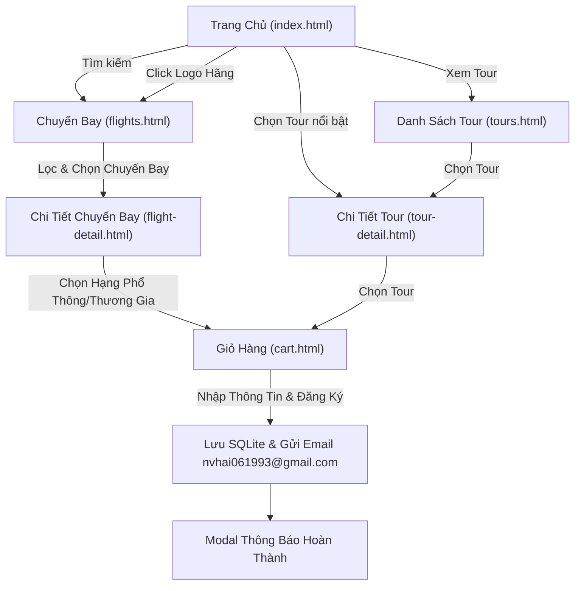

# TÀI LIỆU ĐẶC TẢ YÊU CẦU DỰ ÁN (PRD) - WEBSITE DU LỊCH & ĐẶT VÉ VIETJET

---

## 1. TỔNG QUAN DỰ ÁN

- **Tên dự án / Website:** Vietjet Travel & Flight Booking
- **Lĩnh vực:** Du lịch, Đặt vé máy bay trực tuyến, Tour trọn gói
- **Kiến trúc kỹ thuật:** 
  - **Frontend:** HTML5, CSS3, JavaScript thuần (Vanilla ES6+).
  - **Backend:** Không có backend (Serverless Client-side Architecture).
  - **Cơ sở dữ liệu:** **SQLite** chạy trực tiếp trên trình duyệt qua WebAssembly (`sql.js`), lưu trữ bền vững qua `localStorage` / `IndexedDB`.
  - **Gửi Email:** Tích hợp EmailJS Client SDK (Gửi thông báo từ `nvhai061993@gmail.com`).

---

## 2. NHẬN DIỆN THƯƠNG HIỆU & HỆ THỐNG THIẾT KẾ (DESIGN SYSTEM)

### 2.1. Bảng màu (Color Palette)
- **Màu chủ đạo (Primary):** `#ee1d23` (Đỏ Vietjet đặc trưng - nút bấm, header accent, giá vé nổi bật).
- **Màu phụ (Secondary / Highlight):** `#f8c200` (Vàng Vietjet - badge ưu đãi, sao đánh giá).
- **Màu nền (Background):** `#ffffff` (Nền trắng sáng, sạch sẽ, hiện đại).
- **Màu nền phụ (Light Gray):** `#f8f9fa` và `#f1f3f5` (Nền thẻ card, nền filter sidebar).
- **Màu chữ (Text Primary):** `#212529` (Chữ đen xám đậm dễ đọc).
- **Màu chữ phụ (Text Secondary):** `#6c757d` (Mô tả, ghi chú, thông tin phụ).
- **Màu viền (Border):** `#e9ecef` và `#dee2e6`.
- **Màu trạng thái:**
  - Thành công (Success): `#28a745`
  - Cảnh báo (Warning): `#ffc107`
  - Nguy hiểm/Lỗi (Danger): `#dc3545`

### 2.2. Typography & Phong cách trực quan
- **Font chữ:** `Be Vietnam Pro`, `Roboto` hoặc `Inter` (sans-serif), hỗ trợ tiếng Việt đầy đủ.
- **Phong cách giao diện:** Hiện đại, tối giản, bóng đổ mềm (`box-shadow: 0 4px 15px rgba(0,0,0,0.06)`), bo góc mềm mại (`border-radius: 8px - 12px`).
- **Hình ảnh:** Hình thumbnail tour tỉ lệ chuẩn **600x400**, ảnh máy bay, logo hàng không sắc nét.

---

## 3. CẤU TRÚC TRANG VÀ ĐẶC TẢ CHI TIẾT TÍNH NĂNG

### 3.1. Trang Chủ (`index.html`)

1. **Header & Navigation Bar:**
   - Logo Vietjet (sử dụng file ảnh có sẵn `images/logo.jpg`).
   - Menu điều hướng: Trang Chủ, Chuyến Bay, Tour Du Lịch, Giỏ Hàng (hiển thị số lượng badge), Liên Hệ.
   - Hotline hỗ trợ: `1900 1886`.

2. **Hero Banner & Khung Tìm Kiếm Chuyến Bay:**
   - Banner sử dụng hình ảnh máy bay và tiếp viên Vietjet có sẵn trong thư mục (`images/maybay.jpg`, `images/tiepvien.jpg`).
   - Tab chuyển đổi: **Khứ hồi (Round-trip)** | **Một chiều (One-way)**.
   - Ô chọn: Điểm xuất phát (Hà Nội - HAN, TP.HCM - SGN, Đà Nẵng - DAD, Phú Quốc - PQC, Singapore - SIN...).
   - Ô chọn: Điểm đến.
   - Ô chọn: Ngày đi (Departure Date) và Ngày về (Return Date - disable nếu chọn một chiều).
   - Ô chọn: Số lượng hành khách & Hạng vé (Phổ thông / Thương gia).
   - Nút hành động: **"Tìm Kiếm Chuyến Bay"** (`#ee1d23`) -> Chuyển hướng sang `flights.html` kèm query parameters.

3. **Khu vực Tour Du Lịch Nổi Bật (Featured Tours):**
   - Tiêu đề section: "Tour Du Lịch Hấp Dẫn Nhất".
   - Hiển thị danh sách **8 tour du lịch nổi bật** (dữ liệu lấy từ SQLite DB).
   - Mỗi card tour bao gồm:
     - Hình thumbnail chuẩn kích thước `600x400`.
     - Badge hãng du lịch / hãng bay liên kết.
     - Thời gian: Số ngày / Số đêm (Ví dụ: 4 ngày 3 đêm, 3 ngày 2 đêm).
     - Điểm đến, tên tour.
     - Giá tour (Định dạng VND, màu đỏ `#ee1d23`).
     - Nút "Xem Chi Tiết" -> Chuyển hướng sang `tour-detail.html?id={tour_id}`.

4. **Khu vực Hãng Hàng Không Đối Tác (Airlines Section):**
   - Tiêu đề: "Các Hãng Hàng Không Đồng Hành".
   - Danh sách logo sắc nét các hãng bay:
     - VietJet Air
     - Vietnam Airlines
     - Bamboo Airways
     - Singapore Airlines
     - AirAsia
     - Thai Airways
   - Tương tác: Click vào logo hãng nào sẽ lọc và chuyển ngay đến `flights.html?airline={airline_id}`.

5. **Footer:**
   - Thông tin doanh nghiệp, chính sách điều khoản, chứng nhận, phương thức thanh toán, hotline.

---

### 3.2. Trang Chuyến Bay (`flights.html`)

1. **Thanh tìm kiếm nhanh (Top Search Summary Bar):**
   - Tóm tắt lộ trình (Ví dụ: TP.HCM (SGN) → Hà Nội (HAN), Ngày 15/11, 1 Khách).
   - Nút chỉnh sửa tìm kiếm nhanh.

2. **Cột Trái - Bộ Lọc Chuyến Bay (Filter Sidebar):**
   - **Sắp xếp theo giá:** Giá tăng dần (Mặc định) | Giá giảm dần.
   - **Loại vé:** Vé khứ hồi, Vé một chiều.
   - **Số điểm dừng:** Bay thẳng (Direct), 1 điểm dừng, Nhiều thành phố.
   - **Hãng hàng không (Checkboxes):** VietJet Air, Vietnam Airlines, Bamboo Airways, Singapore Airlines...
   - **Thời gian cất cánh (Giờ):** 
     - Sáng sớm (00:00 - 06:00)
     - Buổi sáng (06:00 - 12:00)
     - Buổi chiều (12:00 - 18:00)
     - Buổi tối (18:00 - 24:00)
   - **Hạng dịch vụ:** Hạng Phổ thông (Economy) | Hạng Thương gia (Business).
   - Nút "Đặt lại bộ lọc".

3. **Cột Phải - Danh Sách Chuyến Bay (Flight Cards):**
   - Thẻ chuyến bay hiển thị:
     - Logo & Tên hãng hàng không.
     - Số hiệu chuyến bay (VJ-124, VN-210, SQ-178...).
     - Giờ cất cánh - Giờ hạ cánh, Mã sân bay đi - đến.
     - Thời gian bay (ví dụ: `2h 10m`), Nhãn "Bay thẳng".
     - Dịch vụ bao gồm: Hành lý xách tay 7kg, Suất ăn, Giải trí trên chuyến bay...
     - Giá vé từ (VND).
     - Nút **"Chọn Chuyến Bay"** -> Dẫn đến `flight-detail.html?id={flight_id}`.

---

### 3.3. Trang Chi Tiết Chuyến Bay (`flight-detail.html`)

1. **Thông tin tổng quan lộ trình:**
   - Điểm đi, Điểm đến, Ngày bay, Giờ cất cánh & Giờ đến.
   - Tên hãng bay, Logo, Số hiệu chuyến bay.
   - Loại máy bay thực tế (Aircraft model: **Airbus A321neo**, **Airbus A330-300**, **Boeing 787-9 Dreamliner**, **Boeing 737 MAX**).
   - Thời gian bay chi tiết và quy định bay.

2. **Khu vực Lựa Chọn Hạng Vé (Fare Classes):**
   - **Hạng Phổ Thông (Economy / Eco):**
     - Giá vé cơ bản.
     - Hành lý xách tay 7kg.
     - Ghế ngồi tiêu chuẩn.
     - Thu phí đổi ngày bay, không hoàn vé.
     - Nút "Chọn Hạng Phổ Thông".
   - **Hạng Thương Gia (SkyBoss / Business Class):**
     - Giá vé cao cấp (x2 đến x2.5 giá Eco).
     - Hành lý xách tay 14kg + Hành lý ký gửi 30kg - 40kg.
     - Ưu tiên làm thủ tục, phòng chờ sang trọng (Lounge), xe đưa đón riêng ra máy bay.
     - Ghế da ngả thoải mái, miễn phí suất ăn nóng cao cấp.
     - Miễn phí thay đổi chuyến bay/ngày bay.
     - Nút "Chọn Hạng Thương Gia".

3. **Hành động Đặt vé:**
   - Click chọn hạng vé -> Lưu thông tin chuyến bay kèm hạng vé vào **Giỏ Hàng (`cart`)** trong SQLite / Storage.
   - Hiển thị Toast thông báo thành công và chuyển hướng (hoặc mở modal) sang `cart.html`.

---

### 3.4. Trang Danh Sách Tour (`tours.html`)

1. **Cột Trái - Bộ Lọc Tour (Filter Sidebar):**
   - **Sắp xếp giá:** Giá tăng dần | Giá giảm dần.
   - **Hãng hàng không liên kết:** VietJet Air, Vietnam Airlines, Bamboo Airways...
   - **Thời gian cất cánh / Giờ khởi hành:** Sáng sớm, Sáng, Chiều, Tối.
   - **Thời lượng tour:** 3N2Đ, 4N3Đ, 5N4Đ.

2. **Cột Phải - Danh Sách Tour Du Lịch:**
   - Danh sách thẻ Tour lớn, bố cục ngang hoặc grid:
     - Hình ảnh đại diện `600x400`.
     - Tên tour & Điểm đến hấp dẫn (Đà Nẵng, Phú Quốc, Nha Trang, Thái Lan, Singapore...).
     - Hãng bay vận chuyển (Logo VietJet Air, Vietnam Airlines...).
     - Ngày cất cánh dự kiến, Thời gian bay.
     - Dịch vụ bao gồm: Khách sạn 4-5 sao, xe đưa đón, vé máy bay khứ hồi, ăn uống theo tour.
     - Giá tour trọn gói (VND).
     - Nút **"Chọn Tour"** -> Chuyển đến `tour-detail.html?id={tour_id}`.

---

### 3.5. Trang Chi Tiết Tour (`tour-detail.html`)

1. **Thông tin đầu trang:**
   - Tên tour trọn gói, Mã tour.
   - Điểm đi, Điểm đến, Thời gian tour (số ngày/đêm).
   - Hãng hàng không chuyên chở và Loại máy bay (Airbus A321, Boeing 787...).
   - Giá tour niêm yết & Các chính sách ưu đãi.

2. **Lịch Trình Chuyến Đi Chi Tiết (Itinerary Accordion / Timeline):**
   - Lịch trình trực quan theo từng ngày:
     - **Ngày 1:** Khởi hành, cất cánh, nhận phòng khách sạn, tham quan các điểm nổi bật đầu tiên.
     - **Ngày 2:** Lịch trình khám phá danh lam thắng cảnh, trải nghiệm ẩm thực địa phương.
     - **Ngày 3:** Hoạt động vui chơi giải trí, tự do mua sắm.
     - **Ngày N:** Trả phòng, mua quà lưu niệm, đáp chuyến bay về lại điểm xuất phát.
   - Danh mục: "Giá tour bao gồm" và "Giá tour không bao gồm".

3. **Hành động Đặt Tour:**
   - Chọn số lượng khách (Người lớn, Trẻ em).
   - Nút **"Chọn Tour / Thêm Vào Giỏ Hàng"** (`#ee1d23`) -> Ghi nhận vào SQLite / Giỏ Hàng -> Chuyển sang `cart.html`.

---

### 3.6. Trang Giỏ Hàng & Thanh Toán Đăng Ký (`cart.html`)

1. **Danh sách các dịch vụ đã chọn:**
   - Bảng / Danh sách hiển thị rõ ràng:
     - Chuyến bay đã chọn (Hãng, Lộ trình, Ngày giờ, Hạng vé, Đơn giá).
     - Tour đã chọn (Tên tour, Ngày khởi hành, Số lượng, Đơn giá).
   - Chức năng: Xóa từng mục, nút "Xóa tất cả giỏ hàng".
   - Tính toán tự động: Tạm tính, Thuế & Phí dịch vụ, **Tổng cộng (VND)**.

2. **Form Nhập Thông Tin Khách Hàng:**
   - Họ và tên khách hàng (Bắt buộc).
   - Số điện thoại liên hệ (Bắt buộc, validate định dạng Việt Nam).
   - Email nhận vé điện tử (Bắt buộc, validate format email).
   - Địa chỉ liên hệ.
   - Ghi chú đặc biệt (Yêu cầu suất ăn, ghế ngồi, hỗ trợ y tế...).

3. **Xử lý Đăng Ký & Thông Báo:**
   - Nút hành động: **"ĐĂNG KÝ & XÁC NHẬN ĐẶT CHỖ"** (`#ee1d23`).
   - Validate thông tin người dùng.
   - Lưu đơn đặt hàng vào bảng `bookings` và `booking_details` trong SQLite DB.
   - Xóa giỏ hàng hiện tại.
   - Hiển thị Popup / Modal thông báo:
     - Biểu tượng thành công xanh lá.
     - "Chúc mừng Quý khách đã đặt vé/tour thành công!".
     - Mã đơn hàng (Booking Reference: ví dụ `VJ-892341`).
   - **Xử lý Gửi Email:**
     - Tích hợp EmailJS: Gửi email tự động xác nhận đơn hàng từ `nvhai061993@gmail.com` đến địa chỉ email mà khách hàng đã nhập trên form.
     - Nội dung email gồm: Mã đặt chỗ, Tên khách hàng, Chi tiết vé máy bay/tour, Tổng tiền, Hướng dẫn thanh toán/check-in.

---

## 4. QUY TRÌNH DỮ LIỆU & TRẠNG THÁI (DATA FLOW)

---

## 5. YÊU CẦU PHI CHỨC NĂNG (NON-FUNCTIONAL REQUIREMENTS)

1. **Hiệu năng & Tốc độ tải trang:**
   - Không phụ thuộc backend, khởi động DB tức thì trong 200ms qua `sql.js` WASM.
   - Giao diện phản hồi mượt mà, chuyển động nhẹ nhàng.
2. **Khả năng tương thích (Responsiveness):**
   - Hiển thị tối ưu trên Desktop (1200px+), Tablet (768px - 1024px) và Mobile (< 768px).
3. **Mã nguồn sạch & Độc lập:**
   - Cấu trúc thư mục rõ ràng, CSS theo BEM hoặc mô-đun hóa, JS chia theo tầng: `db.js`, `cart.js`, `app.js`.
   - Có thể mở trực tiếp bằng Live Server hoặc bất kỳ static server nào (`python -m http.server`, `npx serve`).
